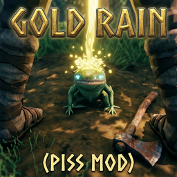

<p align="center">
  
</p>

# Gold Rain (Золотой Дождь) ᚱ
**Viking Urination Mechanic for Valheim with Realistic Golden Arc Physics, 3D Spatial Audio, Multiplayer Sync & In-Game GUI**

[](https://github.com/UncleBugDev/GoldRain/releases/latest)
[](https://thunderstore.io/c/valheim/p/UncleBugDev/GoldRain/)
[](https://valheim.thunderstore.io/package/denikson/BepInExPack_Valheim/)
[](https://opensource.org/licenses/MIT)

**Gold Rain** brings an authentic, hilarious, and meticulously engineered urination mechanic to the harsh Viking world of Valheim. Inspired by the classic CJ animation from *Grand Theft Auto: San Andreas*, this mod procedurally articulates your Viking's skeleton, casts an ultra-optimized parabolic golden stream with dynamic collisions, radiates positional 3D sound, and seamlessly synchronizes across all players on dedicated servers and co-op worlds.

---

## 🌟 Ключевые особенности / Key Features

### 🧎 1. GTA San Andreas Viking Posture (Процедурная поза CJ)
- **Procedural Bone Manipulation:** In `LateUpdate`, your Viking tilts their spine slightly backward (-6°), rotates upper arms forward/inward, and tucks forearms and hands neatly over the belt/groin area.
- **Natural Dynamic Blending:** Works seamlessly with all armor sets, capes, and player scales without clipping into your armor or breaking base animations.
- **Combat & Movement Safety:** Taking damage, attacking, jumping, dodging, opening containers, or moving faster than 0.1 m/s immediately cancels the animation and halts the stream.

### 🟡 2. Optimized Golden Arc Ballistics (Баллистическая физика дуги)
- **True Parabolic Trajectory:** Stream originates precisely at pelvis level (`hips + forward * 0.25 - up * 0.05`) with realistic gravity (`gravityModifier = 1.15`) and adjustable stream velocity (`1.0` to `5.0`).
- **Dynamic Terrain & Piece Collision:** Golden droplets physically collide against ground terrain, rocks, player structures, and building pieces (Ground, Default, and Piece layers).
- **Vibrant Golden Gradient:** Rich `#FFE600` to `#FFB700` golden color with soft fade-out at the tail of the stream.
- **Zero FPS Impact:** Strict particle budget (maximum 50 active particles, ~1.0s lifetime) guarantees 0% performance loss even in dense mega-bases.

### 🔊 3. 3D Spatial Positional Audio (Объемный 3D звук)
- **Positional Attenuation:** Realistic 3D liquid stream sound source anchored directly at the player.
- **Immersive Acoustic Radius:** Full spatial blend (`spatialBlend = 1.0`, logarithmic falloff up to 15m). Other Vikings in your mead hall will hear exactly where and when you are relieving yourself.
- **Configurable Volume:** Easily adjust the master sound level from 0% to 100% or mute entirely.

### 🌐 4. Full Multiplayer & Dedicated Server Sync (Синхронизация мультиплеера)
- **ZNetView RPC Synchronization:** Uses native Valheim network RPCs (`RPC_GoldRain_Pee`) to ensure immediate, zero-bandwidth-overhead visual and audio synchronization across all clients.
- **Late-Join ZDO Persistence:** If a player connects or teleports while you are in the middle of a golden shower, their client instantly catches up and renders your stream.
- **Pure Client/Server Compatibility:** Compatible with vanilla servers when installed client-side (other players without the mod will simply see standard idle posture).

### ⚙️ 5. In-Game ESC Menu & Interactive GUI (Внутриигровое меню настроек)
- **Native ESC Menu Button:** A custom wooden Viking button titled `ᚱ Золотой Дождь` is integrated right into your pause menu next to Settings.
- **Dedicated OnGUI Interface:** Styled in authentic Valheim dark wood and runic aesthetics with Averia typography.
- **Interactive Keybind Listener:** Click "Rebind Hotkey" and press ANY keyboard key or mouse button to rebind on the fly.
- **Toggle vs. Hold Modes:** Choose between pressing once to start/stop (`Toggle`) or holding the key down (`Hold`).
- **Input Guard:** Automatically suppresses the hotkey while typing in in-game Chat or using the F5 console.

---

## 🎮 Управление / Controls

| Action / Действие | Default Key / Клавиша по умолчанию | Description / Описание |
|---|---|---|
| **Pee / Пописать** | `P` | Starts/stops or holds urination stream (depending on mode). / Начать или остановить струю. |
| **Open Menu / Меню настроек** | `ESC` -> `ᚱ Золотой Дождь` | Opens in-game settings GUI. / Открывает окно настроек мода. |
| **Interrupt / Прерывание** | `W, A, S, D`, `Space`, `LMB` | Any movement, jump, or attack cancels immediately. / Любое движение или атака моментально прерывают процесс. |

---

## ⚙️ Configuration / Конфигурация

A configuration file is automatically generated at `BepInEx/config/com.unclebug.goldrain.cfg` on first game run. You can configure it either via the in-game GUI (`ESC -> ᚱ Золотой Дождь`), via BepInEx Configuration Manager (`F1`), or by editing the config file directly:

```ini
[General]
## Enable or disable Gold Rain mod.
# Setting type: Boolean
# Default value: true
ModEnabled = true

## Hotkey to activate pee mechanic.
# Setting type: KeyboardShortcut
# Default value: P
PeeHotkey = P

## Input mode: Toggle (press to start/stop) or Hold (hold down key).
# Setting type: PeeMode
# Default value: Toggle
# Acceptable values: Toggle, Hold
PeeMode = Toggle

## Force and distance of the golden stream (1.0 to 5.0).
# Setting type: Single
# Default value: 3.0
StreamForce = 3.0

## Volume of the 3D stream sound (0.0 to 1.0).
# Setting type: Single
# Default value: 0.6
AudioVolume = 0.6

## Show on-screen notifications when starting or stopping.
# Setting type: Boolean
# Default value: true
ShowNotifications = true
```

---

## 📦 Установка / Installation

### С помощью Thunderstore / r2modman (Рекомендуется)
1. Установите [r2modman](https://valheim.thunderstore.io/package/ebkr/r2modman/) или Thunderstore Mod Manager.
2. Найдите **GoldRain** в каталоге модов Valheim и нажмите **Download**.
3. Запустите игру через менеджер модов (**Start Modded**).

### Ручная установка / Manual Installation
1. Убедитесь, что у вас установлен **BepInExPack Valheim** (v5.4.2202 или новее).
2. Распакуйте архив `GoldRain_v1.0.0.zip`.
3. Поместите файл `GoldRain.dll` в папку `Valheim/BepInEx/plugins/` (или `Valheim/BepInEx/plugins/GoldRain/`).
4. Запустите Valheim.

---

## 🛠️ Совместимость / Compatibility
- **Valheim Version:** Ashlands, Bog Witch, and latest public branch.
- **Multiplayer:** Fully compatible with dedicated servers, local co-op, and crossplay.
- **Mods:** Compatible with all major animation and armor mods. Bones are articulated non-destructively in `LateUpdate`.

---

## 💜 Благодарности и авторы идеи / Credits & Acknowledgements

Мод создан и воплощён в жизнь благодаря идеям, поддержке и вдохновению стримера **DaymonMontage**:
* 🎮 **Twitch канал:** [twitch.tv/daymonmontage](https://www.twitch.tv/daymonmontage)
* 🌐 **Хаб и сайт Daymon:** [daymonmontage.github.io/daymon-site/](https://daymonmontage.github.io/daymon-site/)

---

## 📄 License
Released under the [MIT License](https://opensource.org/licenses/MIT). Created by **UncleBugDev**.
